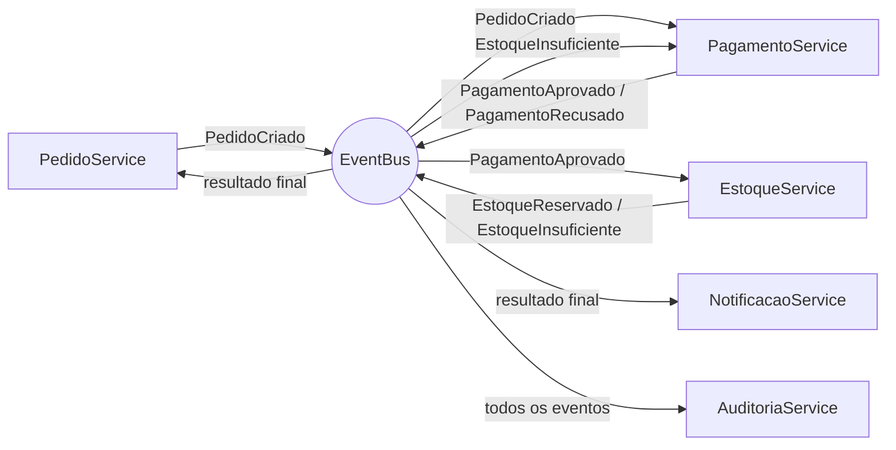

# Arquitetura Orientada a Eventos (EDA) — Sistema de Pedidos

Projeto do seminário de **Desenvolvimento de Sistemas Distribuídos**. Um sistema de pedidos em Java
puro (sem dependências externas) que demonstra, em uma demo interativa no terminal, como serviços
se comunicam por eventos.

## O que é EDA

Em uma arquitetura orientada a eventos, os componentes não se chamam diretamente: eles trocam
**eventos** por meio de um intermediário.

- **Evento:** um fato que já aconteceu, como `PedidoCriado` ou `PagamentoAprovado`.
- **Producer (produtor):** quem publica o evento. Ele não sabe quem vai reagir.
- **Consumer (consumidor):** quem se inscreve em um tipo de evento e reage quando ele chega.
- **Broker (event bus):** o intermediário que recebe os eventos e os entrega aos consumidores.
  Neste projeto, é a classe `EventBus`.
- **Desacoplamento:** produtor e consumidor não se conhecem. Dá para adicionar ou remover um
  consumidor (como a auditoria) sem alterar os outros serviços, e a falha de um não derruba os demais.

> **Observação:** o `EventBus` deste projeto roda em memória, na mesma JVM, e simula o broker para
> fins didáticos. Em produção ele seria substituído por Kafka ou RabbitMQ, com os serviços em
> processos (ou máquinas) diferentes.

## Diagrama do fluxo de eventos



Fluxo de um pedido: `PedidoCriado` → `PagamentoAprovado` → `EstoqueReservado` → pedido confirmado e
cliente notificado. Se o pagamento for recusado ou faltar estoque, o pedido é cancelado e, no caso do
estoque, o pagamento é estornado.

## Estrutura de pastas

```
.
├── pom.xml
├── README.md
├── docs/
└── src/main/java/eda/
    ├── App.java                    # menu interativo da demo
    ├── core/
    │   ├── Event.java              # contrato de todo evento
    │   ├── Envelope.java           # evento + id + data/hora
    │   ├── EventBus.java           # broker: pub/sub, retry, DLQ e event store
    │   └── Log.java                # log com hora, thread e origem
    ├── eventos/
    │   └── Eventos.java            # eventos de domínio
    └── servicos/
        ├── PedidoService.java
        ├── PagamentoService.java
        ├── EstoqueService.java
        ├── NotificacaoService.java
        └── AuditoriaService.java
```

## Como executar

Requisitos: **JDK 21 ou superior** e **Maven**.

```bash
# compilar e gerar o .jar
mvn clean package

# executar o .jar
java -jar target/eda-seminario.jar

# ou executar direto pelo Maven, sem usar o .jar
mvn compile exec:java
```

## Cenários da demo

O programa abre um menu: digite o número da opção e pressione Enter (`0` encerra). Cada opção roda
um cenário e imprime um log com hora, thread e serviço.

| # | Cenário | O que mostra |
|---|---------|--------------|
| 1 | Pedido com sucesso | Fluxo completo: pagamento aprovado, estoque reservado, pedido `CONFIRMADO` e e-mail enviado |
| 2 | Pagamento recusado | Pedido acima de R$ 5.000 é recusado e fica `CANCELADO`; o cliente é avisado |
| 3 | Sem estoque | Pagamento aprovado, mas o estoque não basta; o pagamento é estornado (compensação) e o pedido é cancelado |
| 4 | 3 pedidos ao mesmo tempo | Os `publish()` retornam na hora (status `CRIADO`) e o processamento acontece de forma assíncrona, em threads separadas; depois todos convergem (consistência eventual) |
| 5 | Falha temporária na notificação | O envio falha 2 vezes e funciona na 3ª tentativa (retry) |
| 6 | Falha permanente na notificação | Depois de 3 falhas o evento vai para a Dead Letter Queue; o pedido continua `CONFIRMADO` |
| 7 | Evento duplicado | O mesmo `PagamentoAprovado` é reenviado e o estoque ignora a repetição (idempotência) |
| 8 | Ver Event Store e DLQ | Lista todos os eventos publicados e as mensagens da DLQ. Execute depois de outros cenários, pois a lista começa vazia |

O estoque inicial é Notebook (5), Mouse (50) e Monitor (1), e não é reposto entre os cenários.

## Integrantes

- [**Caio Abreu**](https://github.com/Caio4breu)
- [**Cassiano Abreu**](https://github.com/Nomscodes)
- [**Enzo Aquino**](https://github.com/EnzoAkino)
- [**Gabriel Naoki**](https://github.com/GabrielNaokiUT)
- [**Wyllian Mariano**](https://github.com/wyllianmn)

----
Desenvolvido para fins acadêmicos | Desenvolvimento de Sistemas Distribuídos | 4º período - ADS | Faculdade SENAI FATESG